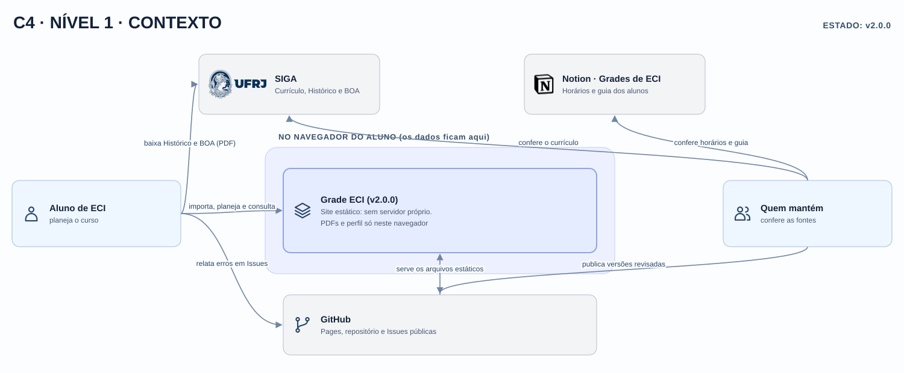

# Grade ECI — Engenharia de Computação e Informação (UFRJ)

A Grade ECI é um site para alunos de Engenharia de Computação e Informação da UFRJ planejarem o curso. Ela reúne num
só lugar o que você já cumpriu e o que falta em cada grupo de créditos, os próximos períodos com requisitos e horários
de referência, os pedidos de equivalência e as horas de extensão. **Você monta uma previsão de formatura ao planejar
os períodos**, para ter uma meta clara e o controle do próprio caminho, de forma agradável e intuitiva.

**A Grade orienta; não substitui o SIGA, o BOA nem a coordenação.** Tudo roda no seu navegador: é um site estático
(HTML, CSS e JavaScript, sem servidor). Mais em [`docs/VISAO.md`](docs/VISAO.md).

## Como abrir

- **No GitHub Pages:** [joaoandrade01.github.io/grade](https://joaoandrade01.github.io/grade/) (ver
  [`docs/PUBLICAR.md`](docs/PUBLICAR.md)).
- **No seu computador:** baixe o repositório e dê dois cliques em `index.html`. Funciona por `file://`, sem instalar nada e
  sem internet.

Na primeira visita o site abre no modo **Clássico**: a grade inteira numa tela e a paleta embaixo. O seletor
"Clássico | Planejador" no topo leva ao **Planejador**, com as abas.

## O que dá para fazer

| Onde | Para quê |
| --- | --- |
| **Grade** | Ver a grade por período, pintar disciplinas com a paleta (**Cursada**, **Cursando**, **Planejada**), destacar pré-requisitos e o que cada disciplina libera, proteger as cursadas com o cadeado e registrar as marcações como aprovações registradas por você. Funciona sem perfil |
| **Importar do SIGA** | Baixar o Histórico e o BOA em PDF, escolher os arquivos, conferir a prévia e usar o perfil. Os PDFs são lidos no navegador |
| **Linha do tempo** | Seus períodos reais, com notas, equivalências, progresso por grupo e avisos de requisito e de oferta |
| **Optativas** | Catálogo com filtros e o guia dos colegas |
| **Cronograma** | Grade semanal dos períodos planejados, com choques, horários de referência e sugestões |
| **Equivalências e Extensão / ACE** | Pedidos de dispensa com carga horária como orientação e prazo de 5 anos, créditos de livre escolha e horas de extensão |
| **Configurações** | Tema, Aparência (Ícone + texto, Só ícones, Minimalista), modo e atalhos; criar, exportar e carregar o perfil; Privacidade; Referências |
| **Foco 🎯** | No Planejador, esconde o que já foi concluído e mostra a fase do curso, a previsão de formatura e as conquistas |
| **A ECI por trás da Grade** | Experiências curtas, com dados fictícios, que mostram como disciplinas do curso aparecem no próprio site |

Os critérios de cada função, por história de uso, estão em [`docs/REQUISITOS.md`](docs/REQUISITOS.md).

## Privacidade

Seus PDFs, seu perfil e seus planos ficam neste navegador e **não são enviados pelo app**; o arquivo que você exporta é
uma cópia sua e pode conter dados acadêmicos e o nome que informou. Detalhes em
[`docs/PRIVACIDADE.md`](docs/PRIVACIDADE.md).

## O que a Grade não confirma

A Grade usa regras da UFRJ e do currículo do SIGA, mas **não confirma** exceções, prazos nem a forma como a coordenação
aplica cada regra. Estimativas e marcações manuais aparecem como tais, com uma nota. Veja a lista em
[`docs/REGRAS-ACADEMICAS.md`](docs/REGRAS-ACADEMICAS.md#o-que-a-grade-não-confirma) e, em caso de dúvida, confira no SIGA
ou com a coordenação.

## Limitações conhecidas

- Os horários e o guia vêm de uma página mantida por alunos e não confirmam a oferta oficial.
- Se o SIGA mudar o layout dos PDFs, a importação pode falhar ou omitir linhas.
- A Grade não calcula uma data de formatura: você monta a previsão com o planejamento.
- A navegação por teclado nos links foi verificada em Chromium e Firefox; Safari no Mac, iPhone real e leitor de tela
  estão pendentes.

A lista completa está em [`docs/MUDANCAS.md`](docs/MUDANCAS.md#limitações-conhecidas).

## Próximos passos

Previsão de formatura calculada, aviso de dado desatualizado, automação da atualização dos horários e do guia com o
Notion, e novas experiências de "A ECI por trás da Grade". A ordem e os critérios estão em
[`docs/MANUTENCAO.md`](docs/MANUTENCAO.md#backlog-e-dívida).

## Quem faz e para quem

Alunos de ECI usam a Grade e podem contribuir; quem mantém revisa as fontes e coordena as atualizações a cada semestre.
A tabela de partes interessadas está em [`docs/VISAO.md`](docs/VISAO.md#partes-interessadas).

## Contribuir

Qualquer aluno pode relatar um erro, propor uma experiência nova ou ajudar a manter os dados. **Use só dados
fictícios**: não anexe PDFs do SIGA, capturas com nome ou matrícula, nem o seu perfil. Veja o
[`CONTRIBUTING.md`](CONTRIBUTING.md) e, para relatar um erro, o link **Achou um erro? Crie uma nova issue** no rodapé
da Grade.

## Uso de IA

Este projeto foi feito com apoio de ferramentas de IA para escrever e revisar código e documentos. Cada mudança é
revisada por uma pessoa e verificada por testes com dados fictícios, e os commits trazem a atribuição
(`Co-Authored-By`). As regras para quem contribui com IA estão em [`CONTRIBUTING.md`](CONTRIBUTING.md#contribuir-com-ia) e
[`AGENTS.md`](AGENTS.md).

## Documentação

| Documento | Conteúdo |
| --- | --- |
| [`docs/VISAO.md`](docs/VISAO.md) | Por que a Grade existe, para quem, condições para publicar |
| [`docs/REQUISITOS.md`](docs/REQUISITOS.md) | Histórias, requisitos e casos de teste |
| [`docs/REGRAS-ACADEMICAS.md`](docs/REGRAS-ACADEMICAS.md) | Regras, fontes, glossário e o que a Grade não confirma |
| [`docs/DECISOES.md`](docs/DECISOES.md) | Decisões e seus motivos |
| [`docs/ARQUITETURA.md`](docs/ARQUITETURA.md) | Como a Grade é feita (modelo C4) |
| [`docs/DESIGN.md`](docs/DESIGN.md) | Identidade visual, critérios de UX e acessibilidade |
| [`docs/PERFIL.md`](docs/PERFIL.md) | Formato do arquivo de perfil |
| [`docs/IMPORTADOR.md`](docs/IMPORTADOR.md) | Como os PDFs do SIGA viram um perfil |
| [`docs/PRIVACIDADE.md`](docs/PRIVACIDADE.md) | O que acontece com os seus dados |
| [`docs/PLANO-DE-TESTE.md`](docs/PLANO-DE-TESTE.md) | Como verificamos uma versão |
| [`docs/PUBLICAR.md`](docs/PUBLICAR.md) | Publicar no GitHub Pages |
| [`docs/MANUTENCAO.md`](docs/MANUTENCAO.md) | Rotina semestral, backlog, métricas e reversão |
| [`docs/MUDANCAS.md`](docs/MUDANCAS.md) | O que mudou em cada versão |
| [`testes/README.md`](testes/README.md) | Como rodar os testes |

## Créditos e licença

- Projeto original: **Grêmio ECI**, [`gremio-eci/grade`](https://github.com/gremio-eci/grade), a partir de
  [carloseduardov8](https://github.com/carloseduardov8/Interactive-Flowchart). Esta Grade é um fork do trabalho deles.
- Logo: Grêmio de ECI.
- Currículo e catálogo: SIGA/UFRJ ([currículo oficial da ECI](https://www.siga.ufrj.br/sira/repositorio-curriculo/distribuicoes/A46B41C8-92A4-F79C-7383-BE627D84214E.html)).
- Horários e guia dos alunos: página "Grades de ECI (Editável)" no Notion, feita por alunos de ECI.
- pdf.js: Mozilla, Apache-2.0 (`js/vendor/LICENSE-pdfjs.txt`). Ícones da interface: Lucide, ISC. As fontes das marcas dos
  diagramas estão na [arquitetura](docs/ARQUITETURA.md).

Licença: AGPL-3.0 (ver `LICENSE`).
