# Arquitetura da Grade ECI

**Pergunta que este documento responde:** como a Grade é feita: de onde vêm os dados, como são transformados e o que
o app entrega, e como o código muda com segurança.

> Resumo: o app é um site **estático** (HTML, CSS e JavaScript, sem servidor próprio nem build). Os dados do curso
> ficam em arquivos `js/*.js` versionados. Os dados pessoais de cada aluno ficam **só no navegador** dele, ou num
> `perfil/perfil.js` local que não vai para o Git ([PRIVACIDADE.md](PRIVACIDADE.md)).

As vistas abaixo seguem o **modelo C4** em três níveis: **contexto**, **contêineres** e **componentes**. Cada vista tem
título, fronteira, relações com sentido e um estado explícito: **v2.0.0** (o que existe) ou **planejado** (o que
ainda não existe). Testes, paridade e publicação aparecem no **fluxo de manutenção**, não dentro do app. Cada
diagrama é gerado por [`diagramas/gerar.js`](diagramas/gerar.js) a partir das mesmas relações: o SVG e o texto
Mermaid de cada vista descrevem o mesmo desenho.

---

## 1. Modelo C4 · estado v2.0.0

### Nível 1 · Contexto

O aluno usa a Grade no próprio navegador. O SIGA fornece o currículo e os PDFs do aluno. O GitHub hospeda o site e recebe
relatos em Issues públicas. Quem mantém confere o SIGA e o Notion e publica versões revisadas.

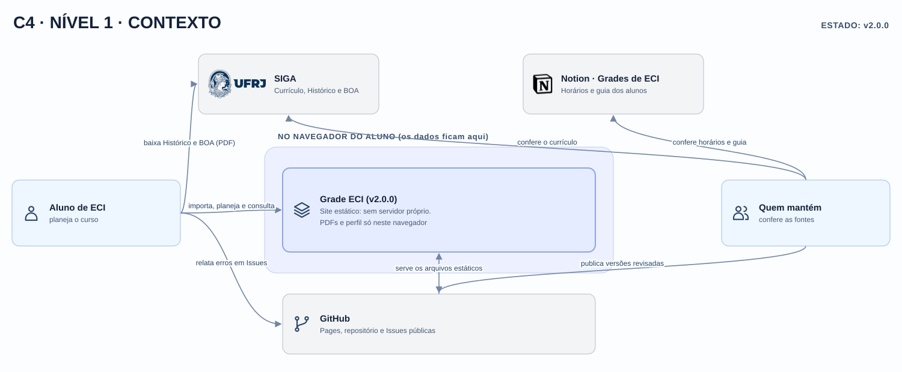

<!-- mermaid:contexto -->
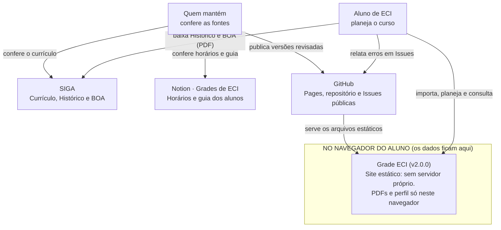
<!-- /mermaid:contexto -->

### Nível 2 · Contêineres

Um contêiner é um limite de execução ou de armazenamento. A aplicação JavaScript roda no navegador e guarda o perfil
no armazenamento local. O GitHub Pages entrega os arquivos estáticos (inclusive os dados de referência). O arquivo
exportado fica no computador, sob controle da pessoa, e o importador de terminal é opcional.

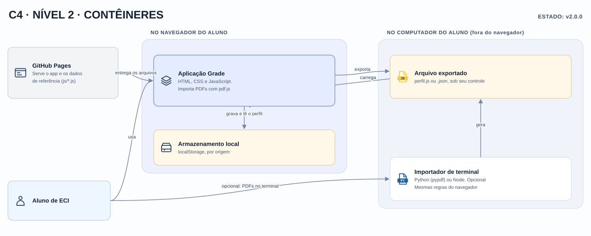

<!-- mermaid:conteineres -->
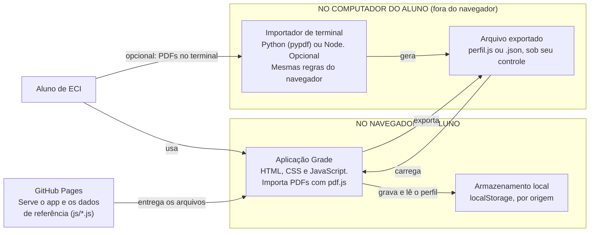
<!-- /mermaid:conteineres -->

### Nível 3 · Componentes da aplicação

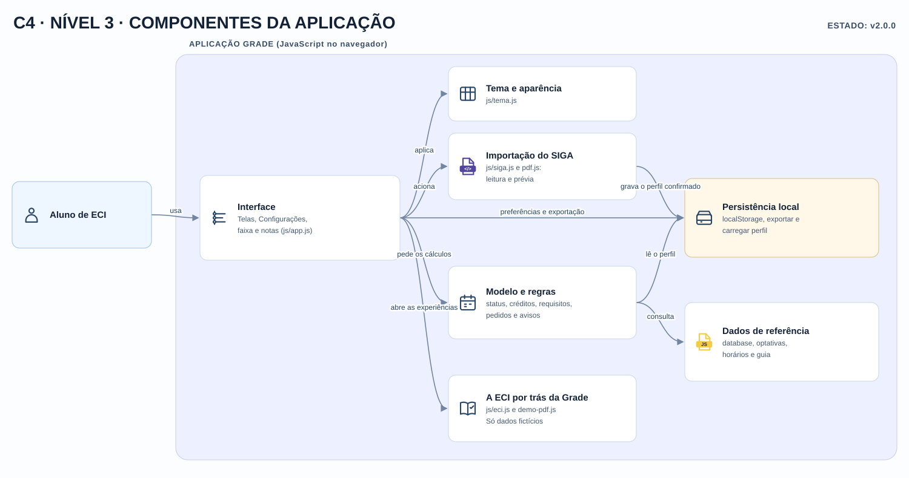

<!-- mermaid:componentes -->
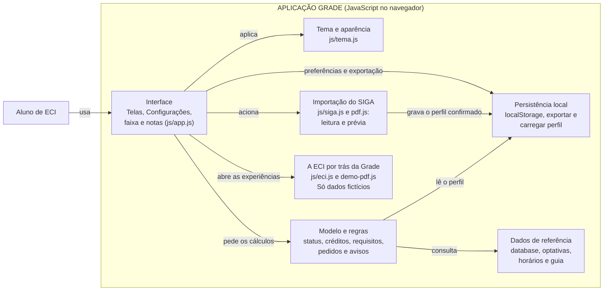
<!-- /mermaid:componentes -->

| Componente | Arquivos | O que faz | Regras e casos |
| --- | --- | --- | --- |
| Interface | `index.html`, `js/app.js`, `static/app.css` | Telas (Grade, Linha do tempo, Optativas, Cronograma, Equivalências e Extensão / ACE), Configurações, faixa e notas, prévia | [DESIGN.md](DESIGN.md), [RF-08](REQUISITOS.md#rf-08--aviso-de-que-a-grade-não-é-oficial-versão-e-relato-d-06), [RF-14](REQUISITOS.md#rf-14--marcação-manual-aparência-tags-e-referências-h1-h3-h10) |
| Tema e aparência | `js/tema.js` (no `<head>`, antes da primeira pintura) | Tema claro ou escuro e formato das abas | [DESIGN.md](DESIGN.md) |
| Importação do SIGA | `js/siga.js`, `js/vendor/` (pdf.js), `ferramentas/gerar_perfil.py` | Lê Histórico e BOA, monta o perfil, prévia | [IMPORTADOR.md](IMPORTADOR.md), [RF-06](REQUISITOS.md#rf-06--importação-do-siga-ra-05-ra-06-ra-17-ra-19-ra-21) |
| Modelo e regras | `js/app.js` (`montaModelo`, `statusDe`, `totais`, `avisos`, `analisaPedido`, `candidatos`, `montaProposta`, `avisoOferta`) | Status, créditos por grupo, requisitos, pedidos, sugestões e avisos de oferta | [REGRAS-ACADEMICAS.md](REGRAS-ACADEMICAS.md), [REQUISITOS.md](REQUISITOS.md) |
| Persistência local | `js/app.js` (`localStorage`, prefixo `gradeECI.v2.`; exportar e carregar) | Guarda e recupera o perfil e as preferências | [PERFIL.md](PERFIL.md), [PRIVACIDADE.md](PRIVACIDADE.md) |
| Dados de referência | `js/database.js`, `js/optativas.js`, `js/horarios.js`, `js/guia.js` | Currículo, catálogo, turmas e guia | [Dicionário das fontes](#dicionário-das-fontes), [RF-17](REQUISITOS.md#rf-17--validação-dos-dados-de-referência-h14) |
| A ECI por trás da Grade | `js/eci.js`, `js/demo-pdf.js` | Experiências com PDFs fictícios; **não** leem nem gravam o perfil | [RF-13](REQUISITOS.md#rf-13--a-eci-por-trás-da-grade-h12) |

Ordem de carga no `index.html`: `js/tema.js` aplica tema e aparência antes da primeira pintura. Os ícones, os dados do
curso, `js/eci.js` e `js/app.js` executam em ordem com `defer`. Na abertura direta por `file://`, o app procura o
perfil local opcional antes de montar a grade. `js/siga.js` e o pdf.js são carregados ao ler PDFs. `js/demo-pdf.js` só é
carregado ao abrir uma experiência que usa os PDFs fictícios.

O site abre no **modo clássico** (seletor de modo no topo): a grade inteira numa tela e a paleta. Desligando o
seletor aparecem as abas. Os dois modos usam os mesmos dados. Em **Configurações** dá para trocar o modo, ocultar o
seletor, escolher a aparência e fixar atalhos.

### Camadas da interface

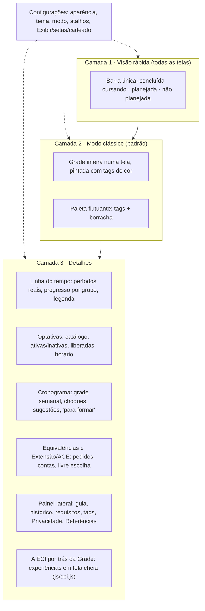

---

## 2. Fluxo de dados · estado v2.0.0

<!-- mermaid:atual -->
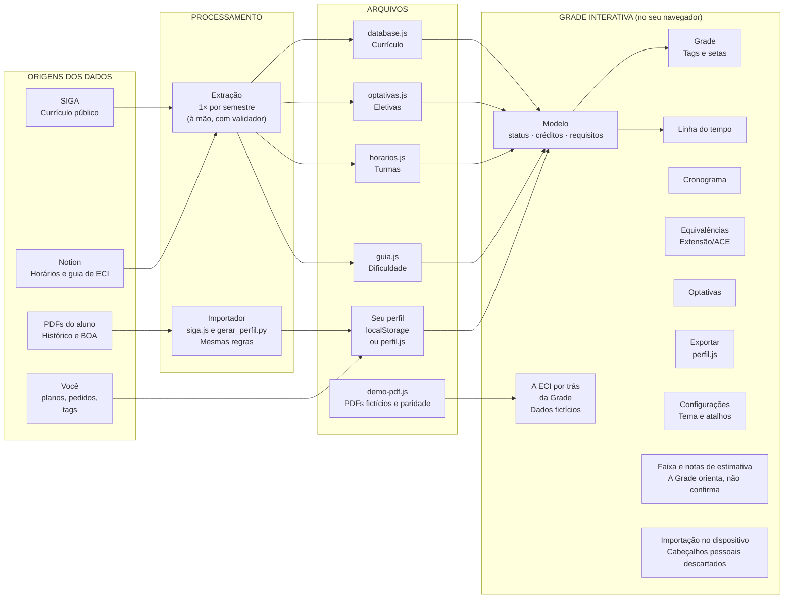
<!-- /mermaid:atual -->

### Dicionário das fontes

| Arquivo | Conteúdo | Fonte | Como é atualizado | Público? |
| --- | --- | --- | --- | --- |
| `js/database.js` | Grade fixa por período, créditos, C.H., requisitos (índices) e a data de conferência (`consultado`) | SIGA · repositório de currículos (ECI 2012/1) | À mão, conferindo a página do currículo ([MANUTENCAO.md](MANUTENCAO.md)) | Sim |
| `js/optativas.js` | Catálogo de eletivas: condicionadas (2), Humanas (4), ACE (5), requisitos por código | SIGA · repositório de currículos | Gerado por script a partir do HTML salvo da página | Sim |
| `js/horarios.js` | Turmas de referência por paridade do semestre (`impar`/`par`) | Notion "Grades de ECI (Editável)" | Cópia manual, conferida pelo validador (RF-17) | Sim |
| `js/guia.js` | Dificuldade, presença e comentários | Notion "Grades de ECI (Editável)" | Cópia manual, conferida pelo validador | Sim |
| `js/siga.js` | Regras de leitura do Histórico e do BOA | — (código) | Ao mudar o layout dos PDFs do SIGA | Sim |
| `perfil/perfil.js` | Perfil pessoal (formato em [PERFIL.md](PERFIL.md)) | PDFs do SIGA + edições do aluno | "Importar do SIGA" ou `gerar_perfil.py`; edições pelo app + exportar | **Não** (`.gitignore`) |
| `js/demo-pdf.js` | PDFs **fictícios** e saída Python pré-computada para "A ECI por trás da Grade" | `ferramentas/gerar_demo_pdf.py` | Ao mudar as regras do importador | Sim (sem dado real) |
| `localStorage` | Perfil importado, tags, marcações, edições e preferências (lista em [PRIVACIDADE.md](PRIVACIDADE.md)) | Navegador | Automático | **Não** (fica no computador) |

### Contrato dos arquivos de referência

- `js/horarios.js` → `window.horarios[curso] = { fonte, consultado, impar: {CÓDIGO: ["ter 10-12", …]}, par: {…}, semCodigo: {impar: […], par: […]} }`
- `js/guia.js` → `window.guia[curso] = { fonte, consultado, niveis, observacoes, disciplinas: {CÓDIGO: {nivel, presenca, descricao, avaliacao, dicas}} }`
- Uma disciplina é **ativa** quando aparece em `impar` ou `par` de `js/horarios.js`. Os códigos e o formato são
  validados pelo kit ([RF-17](REQUISITOS.md#rf-17--validação-dos-dados-de-referência-h14)).

As marcas dos diagramas identificam as fontes dos dados e são incorporadas aos SVGs para consulta offline. A Grade é um
projeto da comunidade de ECI. Para publicação, consulte as orientações de uso das marcas de seus titulares.
[Identidade visual da UFRJ](https://ufrj.br/comunicacao/identidade-visual/) ·
[Diretrizes de marca do Notion](https://notion.notion.site/Notion-Trademark-Usage-Guidelines-9826313c686a4f6e9d8a48347162714b).
Arquivos de origem das marcas: [UFRJ no Wikimedia Commons](https://commons.wikimedia.org/wiki/File:UFRJ_logo.svg) ·
[Notion no Simple Icons](https://github.com/simple-icons/simple-icons/blob/develop/icons/notion.svg).

Para atualizar os diagramas, edite `docs/diagramas/gerar.js` e rode `node docs/diagramas/gerar.js`: ele regenera os SVGs
e os blocos Mermaid deste documento (só entre os marcadores `<!-- mermaid:… -->`).

---

## 3. Fluxo de manutenção · estado v2.0.0 (manual)

Como uma mudança chega ao site. Testes, paridade, validador e publicação ficam aqui, fora do app. O procedimento está em
[PUBLICAR.md](PUBLICAR.md), a lista de verificação em [PLANO-DE-TESTE.md](PLANO-DE-TESTE.md) e a rotina semestral em
[MANUTENCAO.md](MANUTENCAO.md).

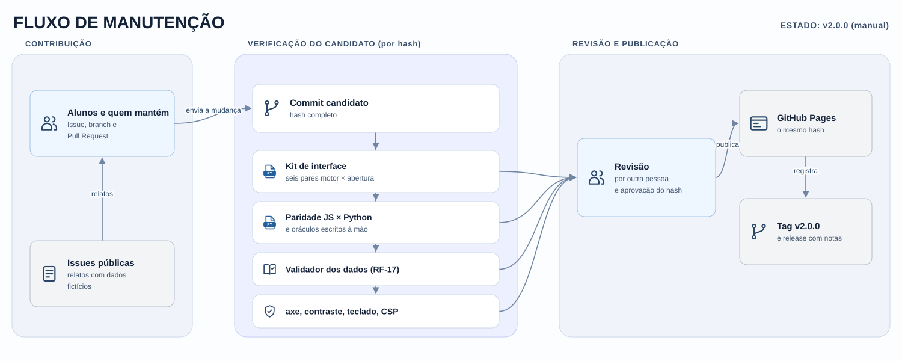

<!-- mermaid:manutencao -->
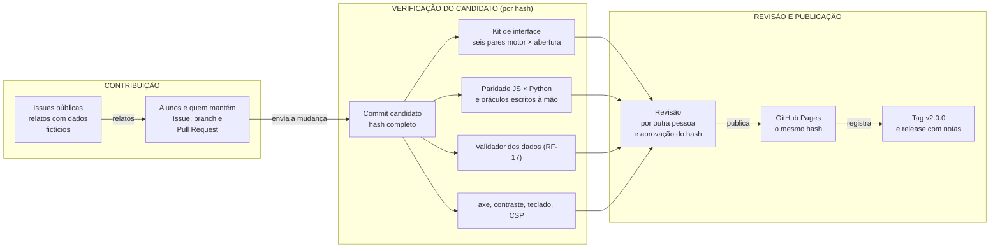
<!-- /mermaid:manutencao -->

---

## 4. Automação com o Notion · **planejada**

> **Não faz parte da v2.0.0.** Hoje os dados do Notion são copiados à mão e conferidos pelo validador
> ([MANUTENCAO.md](MANUTENCAO.md)). Este plano depende de acordo com os autores da página.

**Objetivo:** quem mantém o guia do Notion o atualiza **só lá**, e a Grade propõe a atualização para revisão. Os dados
pessoais continuam fora de qualquer servidor.

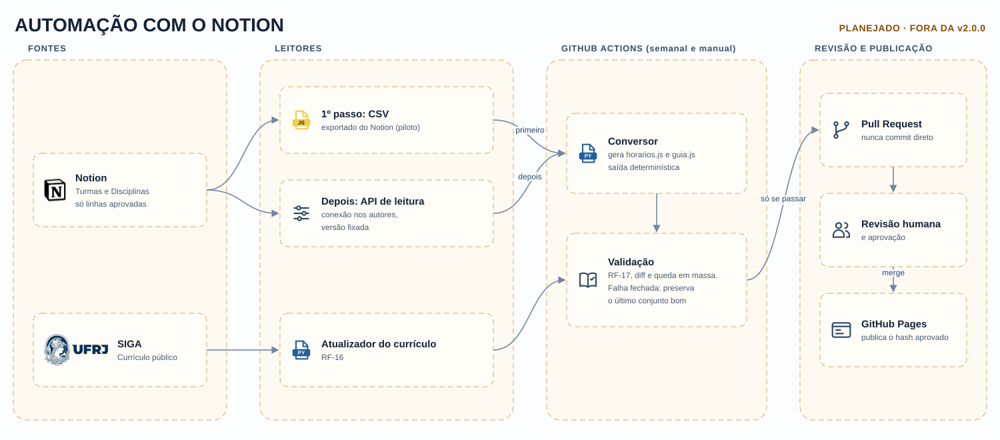

<!-- mermaid:automacao -->
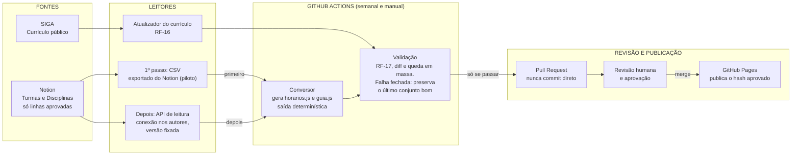
<!-- /mermaid:automacao -->

### Por que o app não lê o Notion direto do navegador

- A API do Notion exige um **token secreto**; colocá-lo num site público o exporia.
- A API não permite chamadas de outros domínios (CORS) sem um servidor intermediário.
- Um arquivo estático gerado é mais rápido, funciona offline e fica versionado (dá para ver o que mudou).

### Passos planejados

| Passo | Entrega | Detalhes |
| --- | --- | --- |
| 1. Bases estruturadas | Bases **Turmas** e **Disciplinas** com o código SIGA como chave, semestre exato, oferta, data e fonte por linha, e aprovação editorial | Combinado com os autores |
| 2. Piloto por CSV | Conversor determinístico com leitor de CSV | Gera `js/horarios.js` e `js/guia.js` no mesmo formato de hoje; saída ordenada para o diff mostrar só mudanças reais |
| 3. Leitura pela API | Segundo leitor do mesmo conversor | Conexão de leitura criada no espaço dos autores; versão da API fixada e reconferida na implementação |
| 4. Rotina | GitHub Actions semanal, com disparo manual | Roda o conversor e o validador; **propõe um Pull Request**, nunca um commit direto |
| 5. Revisão e publicação | Uma pessoa revisa o diff e integra; o Pages publica o hash aprovado | Um commit enviado por workflow com o token padrão não dispara o build do Pages por branch, o que reforça o PR |

**Falha fechada.** Entrada vazia, incompleta ou com queda em massa de linhas não gera Pull Request e preserva os dois
arquivos do último conjunto aprovado. Antes de automatizar remoções, deve existir a política para uma linha antes
aprovada que sumiu ou voltou a rascunho. Os critérios estão em
[RF-15](REQUISITOS.md#rf-15--sincronização-dos-dados-do-notion-h16--planejado), RNF-11 e RNF-13.

A atualização do currículo a partir do SIGA ([RF-16](REQUISITOS.md#rf-16--atualização-do-currículo-a-partir-do-siga-h14--planejado))
segue o mesmo desenho, com falha fechada e relatório de divergências.

---

## 5. Ponto de partida e histórico

A Grade é um fork de [`gremio-eci/grade`](https://github.com/gremio-eci/grade) (AGPL-3.0), que tinha uma única tela com
colunas por período e cliques para pintar disciplinas, estado em cookies e sem histórico real, horários, optativas,
equivalências ou importação. O app atual foi reescrito sem dependências, com estado em `localStorage` indexado por
**código** da disciplina. A página antiga foi retirada
([PUB-01](DECISOES.md#pub-01--retirada-da-página-legada)); o último estado com ela fica na tag `legado-classico` e no
repositório do Grêmio. O registro das mudanças está em [MUDANCAS.md](MUDANCAS.md).

## 6. Privacidade

Detalhes e como verificar: [PRIVACIDADE.md](PRIVACIDADE.md). A extração decodifica cada página em memória e descarta os
cabeçalhos pessoais (`js/siga.js`). Os PDFs são processados no navegador (pdf.js) ou localmente (Python). `perfil/perfil.js`,
PDFs e planilhas estão no `.gitignore`.
