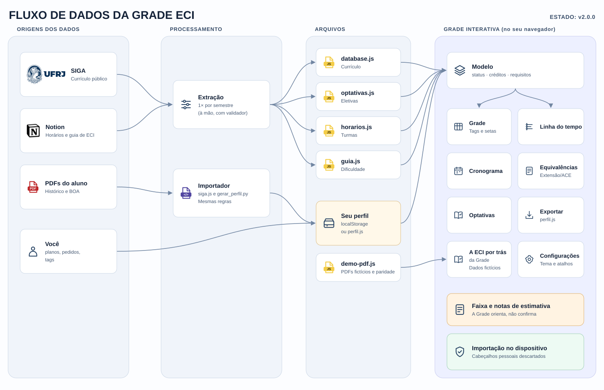
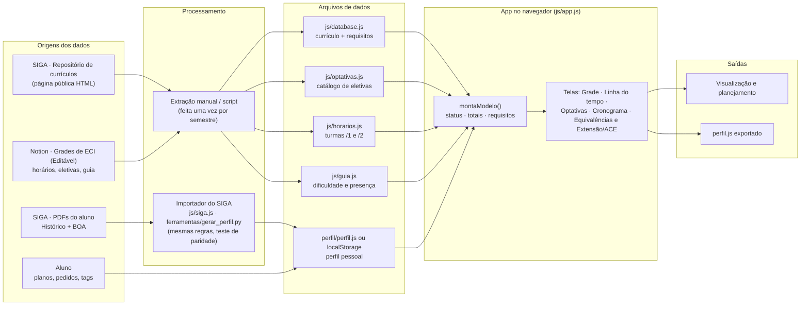
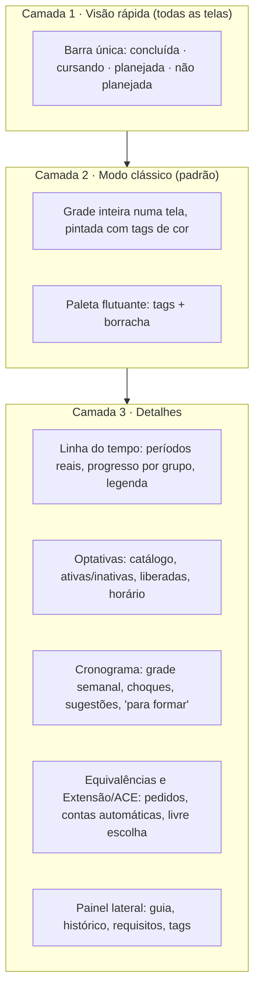
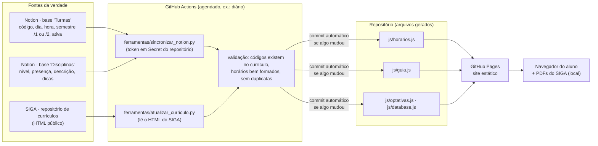

# Arquitetura da Grade Interativa (ECI/UFRJ)

Este documento explica **de onde vêm os dados**, **como eles são transformados** e **o que o app entrega**,
além do **ponto de partida** (o projeto original), das **melhorias** feitas e do **plano para automatizar
tudo** com o Notion como fonte da verdade.

> Resumo: o app é um site **estático** (HTML + JS, sem servidor). Os dados do curso ficam em arquivos `js/*.js`
> versionados; os dados pessoais de cada aluno ficam **só no navegador dele** (ou num `perfil/perfil.js`
> que não vai para o git).

---

## 1. Fluxo de dados (estado atual)

Versão em texto (Mermaid), para editar rápido

### Dicionário das fontes

| Arquivo | Conteúdo | Fonte | Como é atualizado | Público? |
|---|---|---|---|---|
| `js/database.js` | Grade fixa por período, créditos, C.H., requisitos (índices) | SIGA · repositório de currículos (ECI 2012/1) | À mão, conferindo a página do currículo | Sim |
| `js/optativas.js` | Catálogo de eletivas: condicionadas (2), Humanas (4), ACE (5), requisitos por código | SIGA · repositório de currículos | Gerado por script a partir do HTML salvo da página | Sim |
| `js/horarios.js` | Turmas de referência por paridade do semestre (`impar`/`par`) | Notion "Grades de ECI (Editável)" | Hoje: cópia manual. Plano: sincronização automática (seção 5) | Sim |
| `js/guia.js` | Dificuldade 🟢🔵🟡🟠🔴, presença e comentários | Notion "Grades de ECI (Editável)" | Hoje: cópia manual. Plano: sincronização automática | Sim (pedir autorização aos autores) |
| `js/siga.js` | Regras de leitura do Histórico e do BOA | — (código) | Ao mudar o layout dos PDFs do SIGA | Sim |
| `perfil/perfil.js` | Perfil pessoal (períodos, notas, planos, pedidos, extensão, tags) | PDFs do SIGA + edições do aluno | "Importar do SIGA" ou `gerar_perfil.py`; edições pelo app + "Exportar" | **Não** (`.gitignore`) |
| `localStorage` | Perfil importado, tags, marcações, edições, preferências | Navegador | Automático | **Não** (fica no computador) |

---

Para atualizar os diagramas, edite `docs/diagramas/gerar.js` e rode `node docs/diagramas/gerar.js`.
As marcas identificam as fontes dos dados e são incorporadas aos SVGs para consulta offline.
A Grade Interativa é um projeto da comunidade de ECI. Para publicação, consulte as orientações de uso
das marcas de seus titulares. [Identidade visual da UFRJ](https://ufrj.br/comunicacao/identidade-visual/) ·
[Diretrizes de marca do Notion](https://notion.notion.site/Notion-Trademark-Usage-Guidelines-9826313c686a4f6e9d8a48347162714b)

Arquivos de origem das marcas. [UFRJ no Wikimedia Commons](https://commons.wikimedia.org/wiki/File:UFRJ_logo.svg) ·
[Notion no Simple Icons](https://github.com/simple-icons/simple-icons/blob/develop/icons/notion.svg)

## 2. Camadas do app

O site abre no **modo clássico** (interruptor no topo, ligado): só a grade inteira numa tela e a paleta para
pintar. Desligando o interruptor aparecem as abas abaixo. Os dois modos usam os mesmos dados.

### Regras centrais (onde ficam no código)

| Regra | Função em `js/app.js` |
|---|---|
| Status de uma disciplina: marcação do pincel > perfil (aprovado > previsto > cursando > planejado > análise > reprovado) | `statusDe`, `statusPerfil` |
| Tag exibida (cor) deduzida do status; reprovação no período atual = "Reprovação esperada" | `tagDe` |
| Créditos por grupo (obrigatórias, optativas, livre, Humanas, ACE) | `totais` |
| Barra única (só grupos 1–4, cada grupo limitado ao seu total) | `renderBarraGeral` |
| Requisito cumprido antes de um período | `cumpridoAntes`, `avisos` |
| Equivalência deferida conta a pedida e consome as cursadas da livre escolha | `montaModelo` (bloco "Equivalências"), `analisaPedido` |
| Sugestões sem choque para um período | `candidatos`, `montaProposta` |

---

## 3. Ponto de partida

Fork de [`gremio-eci/grade`](https://github.com/gremio-eci/grade) (AGPL-3.0):

- uma única tela com colunas por período e cliques para "pintar" disciplinas concluídas;
- jQuery + noUiSlider, estado em **cookies** indexados pela posição da disciplina na lista;
- `js/database.js` com a grade de ECI e de Farmácia;
- sem histórico real, horários, optativas, equivalências ou importação.

A versão original continua disponível em `classico.html`.

## 4. Melhorias feitas

Detalhe passo a passo em [`docs/MUDANCAS.md`](MUDANCAS.md). Em resumo:

1. App reescrito sem dependências, estado em `localStorage` indexado por **código** da disciplina.
2. Página inicial limpa no estilo clássico, com **tags de cor** editáveis e **barra única** de progresso.
3. **Linha do tempo** com os períodos reais, notas, reprovações, equivalências e dispensas.
4. Catálogo de **optativas** (SIGA), marcação **ativa/inativa** pela oferta do Notion e filtro "cabe na grade".
5. **Cronograma** semanal com choques, horários de referência, sugestões e proposta sem choques.
6. **Equivalências e Extensão/ACE** com pedidos de várias cursadas, checagem de C.H. e do prazo de 5 anos,
   contas automáticas e situação "a pedir".
7. **Importador do SIGA** determinístico (navegador e Python, mesmas regras, teste de paridade).
8. Correções no currículo (requisitos de COS231 e EEL418, créditos do Estágio).

---

## 5. Plano: automatizar com o Notion como fonte da verdade

**Objetivo:** quem mantém o template do Notion atualiza horários, eletivas e o guia **só lá**; o app se
atualiza sozinho. Os dados pessoais continuam fora de qualquer servidor.

### Por que o app não lê o Notion direto do navegador

- A API do Notion exige um **token secreto**; colocá-lo num site público o exporia.
- A API não permite chamadas de outros domínios (CORS) sem um servidor intermediário.
- Um arquivo estático gerado é mais rápido, funciona offline e fica versionado (dá para ver o que mudou).

### Estado-alvo

Versão em texto (Mermaid)

### Etapas

| Etapa | Entrega | Detalhes |
|---|---|---|
| **0. Hoje** | Arquivos `js/*.js` mantidos à mão | Cada arquivo traz `fonte` e `consultado` no topo |
| **1. Bases estruturadas no Notion** | Bases "Turmas" e "Disciplinas" com **código SIGA** como chave | Hoje o Notion usa apelidos ("Alg Lin Comp", "Comp 3"); a coluna **Código** elimina a tradução manual. Coluna **Ativa** (checkbox) controla ativa/inativa |
| **2. Script de sincronização** | `ferramentas/sincronizar_notion.py` | Lê as bases pela API oficial (integração interna, token de leitura), gera `js/horarios.js` e `js/guia.js` no **mesmo formato** de hoje. Saída determinística (ordenada) para que o diff mostre só mudanças reais |
| **3. Atualizador do currículo** | `ferramentas/atualizar_curriculo.py` | Lê a página pública do currículo no SIGA e regenera `js/optativas.js`; confere requisitos de `js/database.js` e avisa divergências |
| **4. Automação** | `.github/workflows/sincronizar.yml` | Agendado (cron) + botão manual; roda 2 e 3, valida e faz commit só se houver diferença. Token do Notion em *Secrets* |
| **5. Publicação** | GitHub Pages | Cada commit publica o site; o app mostra "dados de turmas atualizados em …" a partir do campo `consultado` |

### Contrato de dados (para a sincronização não quebrar o app)

- `js/horarios.js` → `window.horarios[curso] = { fonte, consultado, impar: {CÓDIGO: ["ter 10-12", …]}, par: {…}, semCodigo: {impar: […], par: […]} }`
- `js/guia.js` → `window.guia[curso] = { fonte, consultado, niveis, observacoes, disciplinas: {CÓDIGO: {nivel, presenca, descricao, avaliacao, dicas}} }`
- Uma disciplina é **ativa** quando aparece em `impar` ou `par` de `js/horarios.js`.

---

## 6. Privacidade

Detalhes e como verificar: [`docs/PRIVACIDADE.md`](PRIVACIDADE.md).

- A extração decodifica cada página em memória e descarta os cabeçalhos pessoais (ver `js/siga.js`).
- Os PDFs são processados no navegador (pdf.js) ou localmente (Python); nada é enviado.
- `perfil/perfil.js`, PDFs e planilhas estão no `.gitignore`.
